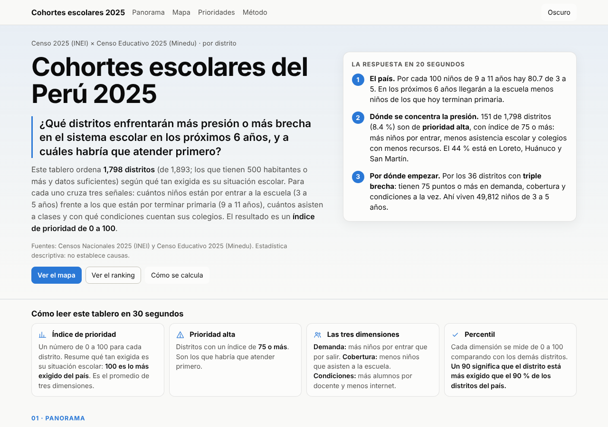
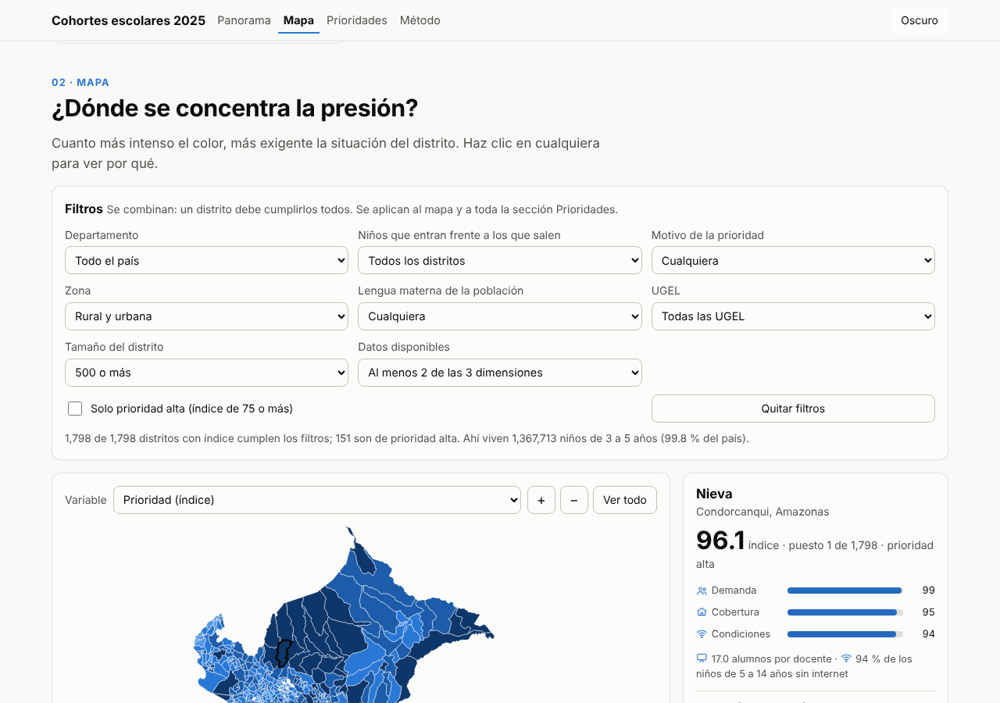
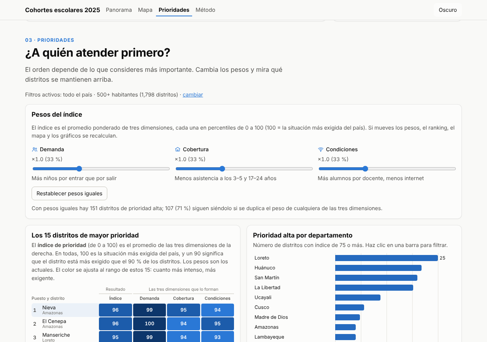

# Cohortes escolares del Perú 2025

**Tarea 3, Python Intermedio** (issue 197 de d2cml-ai/Data-Science-Python). Proyecto individual de **[Tu nombre y apellido]**.

> **Tema:** estructura por edades del Censo 2025 (INEI) y oferta escolar del Censo Educativo 2025 (Minedu), por distrito.
> **Pregunta de investigación (opción B):** ¿qué distritos enfrentarán más presión o más brecha en el sistema escolar en los próximos 6 años, y a cuáles habría que atender primero?

- **Dashboard público:** `https://TU-USUARIO.github.io/TU-REPO/tarea_3/web/` *(completar al publicar; ver «¿Cómo publicar con GitHub Pages?»)*
- **Publicación de LinkedIn:** *(completar)*
- **Reel:** `reel/reel.mp4` (ver `reel/README.md`)





## Respuesta corta

En el Perú hay **80.7 niños de 3 a 5 años por cada 100 de 9 a 11**: en los próximos seis años llegarán a la escuela menos niños de los que hoy terminan primaria. Pero el país no es uniforme. Un índice de prioridad que combina **demanda**, **brecha de cobertura** y **brecha de condiciones** identifica **151 distritos de prioridad alta** (índice ≥ 75 de 100) entre los 1,798 evaluados. Ahí viven 151,020 niños de 3 a 5 años (11.0 % del país). Por ellos habría que empezar, en especial por los **36 distritos con triple brecha**.

Todas las cifras de esta página y del dashboard salen de [`docs/hallazgos.md`](docs/hallazgos.md) y de `web/data/findings.js`, que escribe `scripts/05b_findings.py`.

## Hallazgos

1. **44 % de la prioridad alta está en tres departamentos.** 66 de los 151 distritos de prioridad alta están en Loreto (25), Huánuco (21) y San Martín (20). Loreto pone 9 de los 15 primeros del ranking.
2. **Donde la demanda crece, la cobertura es menor.** En los 194 distritos con más niños de 3 a 5 que de 9 a 11 años, la mediana de asistencia es 77 % a los 3–5 años y 38 % a los 17–24 años; en los 1,586 donde la demanda se achica, 80 % y 47 %.
3. **Triple brecha.** 36 distritos están en el 25 % más exigido del país en las tres dimensiones a la vez. Ahí viven 49,812 niños de 3 a 5 años.
4. **En la prioridad alta hay más alumnos por docente y menos internet.** La mediana es 14.4 alumnos por docente en los distritos de prioridad alta y 10.3 en el resto. Usa internet el 26 % de los niños de 5 a 14 años en los primeros, contra 37 % en el resto.
5. **La otra presión: aulas que se vacían.** 351 distritos se achican con certeza estadística y ahí vive el 63 % de los niños de 6 a 11 años del país (48 % de ellos en Lima y Callao). No son prioridad por brecha, pero sí necesitan planificar menos matrícula.

**Top 5 de prioridad:** Nieva y El Cenepa (Amazonas), Manseriche (Loreto), Tahuania (Ucayali) y Andoas (Loreto). Los nombres se escriben como vienen en la fuente (sin tilde). El Top 15 completo está en `docs/hallazgos.md` y en el dashboard.

## ¿Qué tiene el dashboard?

Es una sola página (`web/index.html`) en JavaScript puro, sin librerías ni CDN. Funciona abriendo el archivo con doble clic (`file://`) y en GitHub Pages. Tiene modo claro y oscuro, íconos propios y está diseñada primero para celular (390 px). Tiene modo claro y oscuro, y está diseñada primero para celular (390 px).

| Sección | Contenido |
|---|---|
| Cabecera | Título, pregunta, contexto y navegación fija con botón de tema |
| 1. Panorama | Cifra principal (151 distritos de prioridad alta), 4 KPIs, la respuesta en 20 segundos, qué es el IRC y los 5 hallazgos |
| 2. Mapa | Filtros comunes (departamento, niños que entran frente a los que salen, motivo de la prioridad, zona rural o urbana, tamaño del distrito, datos disponibles y solo prioridad alta), con el total de niños de 3 a 5 años de la selección. Mapa coroplético de canvas con zoom, arrastre, acercamiento al departamento elegido y selector de variable (prioridad, las tres dimensiones, IRC y los indicadores de base: asistencia, alumnos por docente, internet y ruralidad). Panel de detalle con las tres dimensiones. Lista de 69 distritos sin mapa |
| 3. Prioridades | Sliders de pesos que recalculan el índice en vivo, matriz de calor del Top 15, qué tipo de respuesta sugiere cada motivo, prioridad alta por departamento, dispersión IRC vs. ruralidad, comparador de dos distritos y tabla ordenable y buscable con descarga CSV |
| 4. Método y límites | Pasos, límites, fuentes, aviso de que no es una proyección oficial y créditos |

Cada gráfico tiene un tooltip y una vista "Ver como tabla". El foco por teclado muestra lo mismo que el hover: en el mapa y la dispersión se recorren los distritos con las flechas, y las barras se recorren con Tab.

## ¿Cómo se calcula?

Solo conteos, razones, percentiles y diferencias; no hay econometría.

1. **Demanda:** IRC del distrito = niños de 3 a 5 años ÷ niños de 9 a 11 años (Censo 2025). Un IRC mayor que 1 indica que la demanda crece.
2. **Brecha de cobertura:** proporción que no asiste a una institución educativa a los 3–5 y a los 17–24 años.
3. **Brecha de condiciones:** alumnos por docente (Censo Educativo 2025) y proporción de niños de 5 a 14 años que no usa internet.
4. **Percentiles:** cada indicador se convierte en percentil (0 a 100, donde 100 es lo más exigido) entre los distritos con 500 habitantes o más. Cada dimensión se redondea a un decimal.
5. **Índice:** promedio ponderado de las dimensiones disponibles (al menos 2). Por defecto los tres pesos valen 1 (`config.json`). El dashboard usa la misma fórmula (`web/indice.js`) y la prueba `RankingDashboard` comprueba que, con pesos iguales, reproduce `prioridad_distrito.csv` posición por posición.
6. **Prioridad alta:** índice ≥ 75 (`config.json → prioridad.prioridad_alta_min`).

La tipología de cohortes (contracción, estable o incierto, expansión, muestra pequeña) usa un intervalo de Wilson al 95 % sobre el IRC: 351 distritos en contracción, 750 estables o inciertos, 21 en expansión y 771 con muestra pequeña.

**Validaciones:** los alumnos de colegios públicos del padrón suman 6,731,402, igual que la cifra oficial del Minedu. La suma de edades simples difiere en 0.016 % de la población censada.

## Fuentes

| Fuente | Uso |
|---|---|
| [INEI, Censos Nacionales 2025, tabulados de población](https://censos2025.inei.gob.pe/resultados/descarga-de-datos/cuadros-estadisticos/tabulados/tabulados-poblacion) | Edad simple, asistencia escolar, omisión censal y uso de internet por distrito |
| [Minedu, ESCALE, Censo Educativo 2025](https://escale.minedu.gob.pe) | Padrón de instituciones educativas (alumnos y docentes). Solo se publican agregados por distrito |
| [juaneladio/peru-geojson](https://github.com/juaneladio/peru-geojson) (MPL-2.0) | Polígonos distritales simplificados |

## ¿Qué límites tiene?

- **Nombres.** Los nombres de distritos se muestran como vienen en la fuente; algunos no llevan tilde.
- **Residencia, no colegio.** El censo cuenta a los niños donde viven; un niño puede estudiar en otro distrito.
- **Polígonos de ~2015.** 69 distritos no tienen polígono: no aparecen en el mapa, pero sí en el ranking, los gráficos y la tabla.
- **Omisión censal.** En 117 distritos la omisión estimada supera el 8 % (9 de ellos son de prioridad alta).
- **No es una proyección.** El IRC compara dos cohortes del mismo año; no incluye migración, mortalidad ni repitencia.
- **Sin índice.** 95 distritos quedan fuera del índice por tener menos de 500 habitantes o menos de 2 dimensiones con datos.
- Es un **análisis de apoyo**, no una proyección oficial. No recomienda abrir ni cerrar colegios.

## Diseño

- Magnitudes: una sola gama azul en 5 clases. En modo claro va de `#86b6ef` a `#0d366b`; en modo oscuro, de `#184f95` a `#b7d3f6` (el valor alto es el más claro).
- IRC (crece o se achica): par divergente rojo/azul con gris neutro en el centro (0.9–1.1).
- Colores categóricos: solo dos, azul y naranja (prioridad alta y comparador). No se usan colores de estado para series.
- Paletas validadas con el validador de la skill *dataviz* (`validate_palette.js`), en modo claro y oscuro: categórica (`--pairs all`), rampa ordinal y polos del divergente. El primer intento falló en dos puntos y se corrigió: el paso más claro de la rampa (`#cde2fb`, contraste 1.29:1) y el polo azul del divergente en oscuro (`#5598e7`, fuera de la banda de luminosidad).

## Estructura del repositorio

```
tarea_3/
├── README.md
├── config.json                 parámetros (edades, umbrales, pesos, prioridad alta)
├── run_all.sh                  corre toda la tubería (o solo la parte web: bash run_all.sh web)
├── scripts/
│   ├── 01, 01b, 02, 03, 04     lectura de INEI y Minedu, cruce de ubigeos, indicadores
│   ├── 04b_prioridad.py        índice de prioridad -> prioridad_distrito.csv
│   ├── 05_build_web.py         une indicadores + prioridad -> web/data/distritos.js, geometria.js
│   ├── 05b_findings.py         KPIs, Top 15, hallazgos y conteos -> web/data/findings.js, docs/hallazgos.md
│   └── 06, 07                  imágenes y video del reel
├── data/processed/             tablas por distrito (CSV)
├── web/                        dashboard: index.html, styles.css, app.js, indice.js, data/
├── docs/                       hallazgos.md (generado), diccionario de datos, LinkedIn, issue, img/
├── reel/
└── tests/                      test_consistencia.py y verificar_dashboard.js (Playwright)
```

## ¿Cómo reproducir los resultados?

```bash
pip install -r requirements.txt
# Con los datos crudos en data/raw/ (ver data/raw/README.md):
bash run_all.sh
# Solo índice, datos web, hallazgos y pruebas, a partir de data/processed/:
bash run_all.sh web
# Pruebas
python -m unittest discover tests
# Verificación visual (opcional, requiere Chrome y: npm install playwright-core)
node tests/verificar_dashboard.js docs/img/verificacion final
```

Si `data/raw/peru_distrital_simple.geojson` no está, `05_build_web.py` reutiliza los polígonos que ya tiene `web/data/geometria.js`.

## ¿Cómo publicar con GitHub Pages?

GitHub Pages solo publica desde la raíz del repositorio (`/ (root)`) o desde una carpeta `/docs` en la raíz. **No** permite elegir `/web` ni `tarea_3/web` directamente. Como este repositorio (`Cursos`) tiene varias tareas, la opción más simple es:

1. Sube la rama a GitHub y únela a `main`.
2. En el repositorio: **Settings → Pages → Build and deployment → Source: Deploy from a branch**.
3. Elige **Branch: `main`** y carpeta **`/ (root)`**, y guarda.
4. Después de uno o dos minutos, el dashboard queda en `https://TU-USUARIO.github.io/Cursos/tarea_3/web/`.

Otra opción, si prefieres que la URL apunte solo al dashboard: copia el contenido de `tarea_3/web/` a una carpeta `docs/` en la raíz del repositorio y elige `/docs` en el paso 3. También se puede publicar `tarea_3/web` con un flujo de GitHub Actions ("Static HTML").

No hace falta compilar nada: los datos se cargan con `<script src="data/*.js">`.

## ¿Cómo usar estos resultados?

Sirven para decidir **dónde mirar primero**, no para decidir qué hacer en cada distrito. El dashboard muestra, para cada distrito, su **motivo de prioridad** (más niños por atender, menos asistencia escolar, pocos docentes e internet) cuando esa dimensión llega a 75 puntos o más, y si su prioridad **se mantiene al cambiar los pesos**: 107 de los 151 distritos siguen en prioridad alta si se duplica el peso de cualquiera de las tres dimensiones. Conviene contrastarlos con datos de las UGEL, con los flujos de estudiantes entre distritos y con los proyectos en curso. No son una proyección oficial ni sirven para abrir o cerrar colegios.

## Declaración de uso de IA

Este proyecto se desarrolló con asistencia de **Claude (Anthropic)**: exploración de datos, código, diseño del tablero, verificación con Playwright y redacción. Las decisiones de tema, pregunta y enfoque, y la revisión de los resultados, son de la autora. La **voz del reel es sintética**, generada con IA a partir de una grabación propia de la autora. Los datos son públicos (INEI y Minedu). No hay claves ni datos personales en el repositorio: el padrón (`Padron.dbf`) no se publica porque contiene nombres de directores y teléfonos; solo se suben agregados por distrito.
