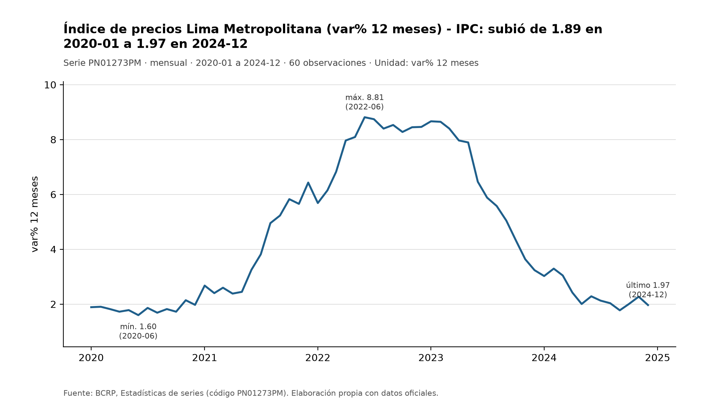
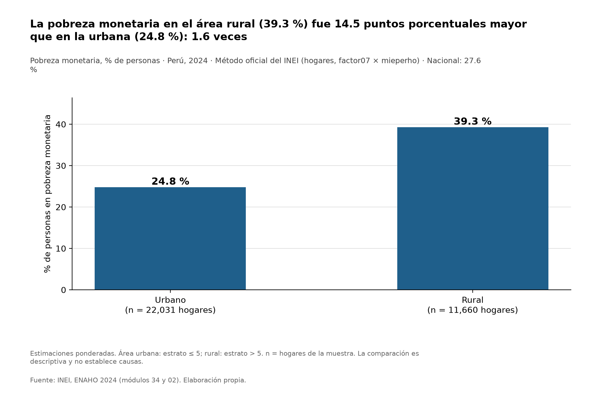
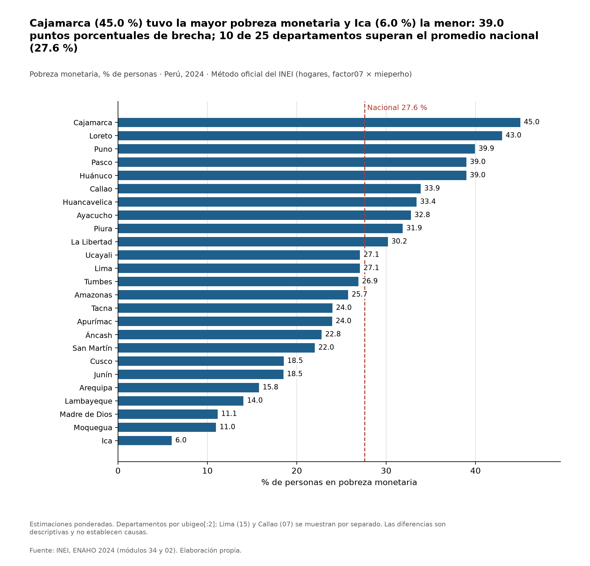
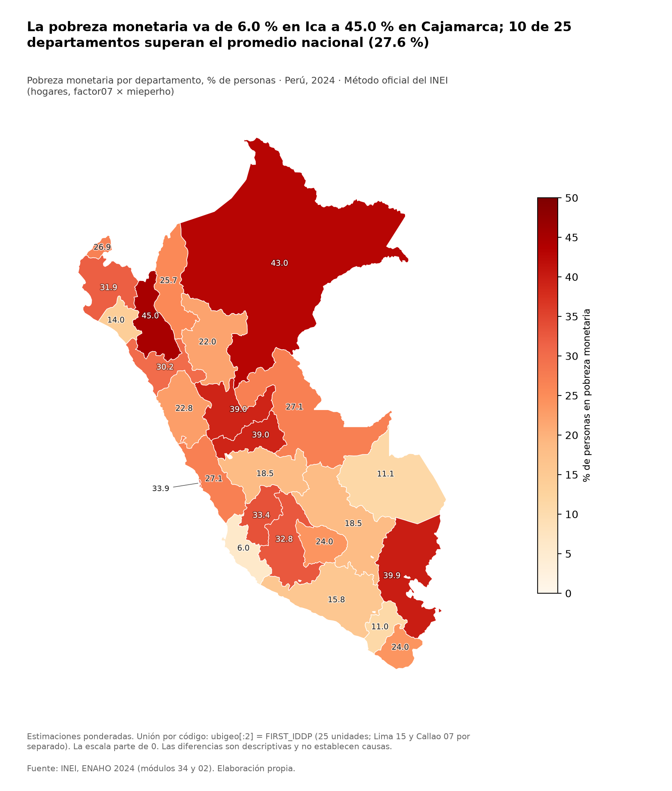

# Inflación en Lima y pobreza territorial en el Perú

Informe elaborado con un agente de Claude Code que coordinó el servidor MCP del BCRP y las Skills de ENAHO. Toda cifra de este documento está en `trazabilidad.md`, que se genera desde los resultados de las herramientas; `verificar_informe.py` comprueba que no haya ninguna que no figure allí.

## 1. Pregunta de investigación

> ¿Cómo evolucionó la inflación a 12 meses en Lima entre 2020 y 2024, y qué diferencias territoriales (urbano/rural y departamental) presentaba la pobreza monetaria en 2024?

**Objetivo.** Describir, con fuentes oficiales, (a) la trayectoria de la inflación a 12 meses de Lima Metropolitana y (b) cómo se distribuyó la pobreza monetaria entre áreas y departamentos del país.

**Delimitación.** Es un análisis descriptivo con dos fuentes que no comparten unidad de análisis ni período: una serie mensual del BCRP y una encuesta anual del INEI. El informe las presenta una junto a la otra; no estima ninguna relación entre ellas (ver Limitaciones).

## 2. Fuentes y metodología

**BCRP.** Serie `PN01273PM`, *Índice de precios Lima Metropolitana (var% 12 meses) - IPC*, mensual, de 2020-01 a 2024-12 (60 observaciones). Se consultó con el servidor MCP `bcrp`, usando 5 herramientas distintas: `buscar_series` (para ubicar el código), el recurso `bcrp://serie/PN01273PM` (su ficha), `resumen` (cifras calculadas por Python), `serie` (los valores mensuales) y `graficar_serie` (el gráfico). Fuente de los datos: API de estadísticas del BCRP.

**ENAHO 2024 (INEI).** Módulos 34 (sumaria, hogares) y 02 (miembros). La skill `limpiando-enaho` filtra residentes habituales, une personas y hogares con `merge(validate="m:1")`, construye departamento (`ubigeo[:2]`) y área (urbano si `estrato` ≤ 5) y valida la base: 108,664 residentes habituales y 33,691 hogares, con 16 verificaciones aprobadas y 0 fallidas. Los porcentajes de pobreza son **estimaciones ponderadas** con el método oficial del INEI (a nivel de hogar, `factor07 × mieperho`), expresadas como % de personas. Las skills `graficando-enaho` y `mapeando-enaho` produjeron los gráficos y el mapa; el mapa une por código (`ubigeo[:2]` con `FIRST_IDDP`), no por nombre, y reproduce los 25 departamentos de la referencia de la sesión 16.

**Integración.** Todo ocurrió en una sola ejecución de `claude -p` (16 llamadas a herramientas, 5 herramientas MCP y 3 skills distintas). Al empezar no existía `salidas/personas_2024.parquet`: el agente ejecutó `limpiando-enaho` antes de graficar y mapear. El registro está en `evidencias_ia/integracion/ejecucion.jsonl`. Las cifras del BCRP se tomaron de las respuestas de las herramientas en ese registro, sin reconsultar la API; la sección de verificación sí la consulta de nuevo, y lo declara.

## 3. Resultados

### Hallazgo 1: la inflación a 12 meses subió hasta 8.81 % en 2022-06 y terminó el período en 1.97 %

La tasa empezó en 1.89 % en 2020-01 y tocó su mínimo, 1.60 %, en 2020-06. Sus valores de diciembre fueron 1.97 % (2020-12), 6.43 % (2021-12), 8.46 % (2022-12), 3.24 % (2023-12) y 1.97 % (2024-12). El máximo fue 8.81 % en 2022-06; desde entonces hasta el último dato pasaron 30 meses y la tasa cayó 6.85 puntos porcentuales. Los promedios anuales de las tasas mensuales lo confirman: 1.83 % en 2020, 3.97 % en 2021, 7.86 % en 2022, 6.31 % en 2023 y 2.35 % en 2024. En todo el período el cambio entre el primer y el último dato fue de solo 0.08 puntos porcentuales: terminó casi donde empezó, pero con un recorrido muy distinto en medio.

### Hallazgo 2: la pobreza rural (39.3 %) superó a la urbana (24.8 %) en 14.5 puntos porcentuales

En 2024 la pobreza monetaria nacional fue 27.6 %. En el área rural fue 39.3 % y en la urbana 24.8 %: una diferencia de 14.5 puntos porcentuales, o 1.6 veces. Las cifras descansan en 22,031 hogares urbanos y 11,660 hogares rurales de la muestra.

### Hallazgo 3: entre departamentos, la pobreza va de 6.0 % en Ica a 45.0 % en Cajamarca

La brecha entre el departamento con mayor pobreza y el de menor pobreza es de 39.0 puntos porcentuales. Después de Cajamarca (45.0 %) siguen Loreto (43.0 %), Puno (39.9 %), Pasco (39.0 %) y Huánuco (39.0 %). Los más bajos, además de Ica (6.0 %), son Moquegua (11.0 %), Madre de Dios (11.1 %) y Lambayeque (14.0 %). De los 25 departamentos, 10 superan el promedio nacional (27.6 %) y 15 no lo superan.

### Hallazgo 4: la dispersión entre departamentos es mayor que la brecha entre áreas

Solo 3 departamentos (Cajamarca, Loreto y Puno) tienen una pobreza mayor que la rural nacional (39.3 %), y 11 tienen una pobreza menor que la urbana nacional (24.8 %). La brecha entre extremos departamentales (39.0 puntos porcentuales) es más grande que la brecha entre áreas (14.5 puntos porcentuales). Lima (15) y Callao (07), que el mapa mantiene separados, tienen 27.1 % y 33.9 %: el Callao queda por encima del promedio nacional y Lima apenas por debajo del 27.6 % nacional, aunque no se calcula aquí si esa diferencia es estadísticamente distinta de cero.

## 4. Visualizaciones



*Figura 1.* Inflación a 12 meses, Lima Metropolitana (serie `PN01273PM`). Generada con `graficar_serie`.



*Figura 2.* Pobreza monetaria por área, ENAHO 2024, método oficial. Generada con `graficando-enaho`.



*Figura 3.* Pobreza monetaria por departamento, ENAHO 2024. Generada con `graficando-enaho`.



*Figura 4.* Mapa de pobreza monetaria por departamento, ENAHO 2024, con los 25 departamentos. Generada con `mapeando-enaho`.

## 5. Interpretación

La inflación a 12 meses de Lima Metropolitana siguió una trayectoria en forma de colina: se movió alrededor de 1.83 % en promedio durante 2020, escaló durante 2021 y 2022 hasta su máximo, bajó con fuerza en 2023 y terminó 2024 en un nivel prácticamente igual al de diciembre de 2020 (1.97 % en ambos casos). Los promedios anuales muestran que el año más alto fue 2022 y que 2024 volvió a un nivel cercano al de 2020.

La pobreza monetaria de 2024 presentó una desigualdad territorial marcada. Primero entre áreas: en el área rural fue 1.6 veces la urbana. Después entre departamentos, donde la diferencia entre los extremos fue de 39.0 puntos porcentuales y mayor que la brecha entre áreas. Como los departamentos mezclan zonas urbanas y rurales en proporciones distintas, la comparación departamental y la de áreas son miradas complementarias, no una descomposición una de la otra.

Los dos conjuntos de resultados se presentan juntos porque la pregunta lo pide, pero **este análisis no muestra que la inflación y la pobreza estén relacionadas**: no hay una serie de pobreza para 2020–2023, la inflación es de Lima Metropolitana y la pobreza es de todo el país, y las diferencias que se describen entre grupos no prueban causas.

## 6. Limitaciones

- **Distintos niveles de agregación.** La inflación es mensual y de Lima Metropolitana; la pobreza es anual (2024), por área y departamento. El departamento Lima (15) de la ENAHO no es Lima Metropolitana y excluye al Callao (07).
- **Un solo año de pobreza.** La ENAHO 2024 cubre el año completo, por lo que no permite aislar un mes ni comparar con 2020–2023 en este análisis. Por eso la pregunta se formuló "en 2024" y no sobre un mes de cierre.
- **Sin causalidad ni asociación estimada.** No se calculó ninguna correlación entre las dos fuentes, y las diferencias entre áreas y departamentos son descriptivas.
- **Sin intervalos de confianza.** Son estimaciones puntuales. Las muestras departamentales varían mucho: desde 603 hogares en Madre de Dios hasta 4,544 en Lima.
- **Método de ponderación.** Se usó el oficial del INEI (hogares, `factor07 × mieperho`). El cálculo por personas con `facpob07` difiere unas décimas; la diferencia está documentada en `salidas/validacion.txt`.
- **Datos del BCRP.** Las cifras corresponden a la consulta hecha durante la ejecución; la ficha del catálogo indica como última actualización 2026-10-08 y el BCRP puede revisar sus series.
- **Título del gráfico del BCRP.** El título automático de la Figura 1 describe los extremos del período ("subió de 1.89 a 1.97") y no refleja el pico intermedio; la forma de la serie se ve en el propio gráfico y en los hallazgos.
- **Alcance de la verificación automática.** `verificar_informe.py` comprueba que cada número exista en `trazabilidad.md`, no que se use en el contexto correcto; esa revisión es de lectura.
- **Fallos de herramientas.** En esta ejecución ninguna herramienta falló. Si alguna lo hubiera hecho, el informe lo habría declarado en lugar de rellenar cifras.

## 7. Verificación de cifras

Se compararon cifras del informe con la fuente consultada por un camino independiente: los datos del BCRP con un pedido directo a su API (sin pasar por el servidor MCP) y la pobreza con un recálculo desde `sumaria-2024.dta` (sin usar `limpiar.py`). Los valores del informe están redondeados; la comparación se hace con los valores sin redondear.

| Afirmación del informe | Valor del informe | Valor de las herramientas | Valor independiente | Diferencia | ¿Coincide? |
|---|---|---|---|---|---|
| Inflación a 12 meses en 2020-01 | 1.89 | 1.888356 | 1.888356 | 0.000000 | sí |
| Inflación máxima, 2022-06 | 8.81 | 8.812633 | 8.812633 | 0.000000 | sí |
| Inflación en 2024-12 | 1.97 | 1.966303 | 1.966303 | 0.000000 | sí |
| Pobreza urbana | 24.8 | 24.807000 | 24.806989 | 0.000011 | sí |
| Pobreza rural | 39.3 | 39.302800 | 39.302794 | 0.000006 | sí |
| Pobreza en Cajamarca (06) | 45.0 | 45.006900 | 45.006897 | 0.000003 | sí |
| Pobreza en Ica (11) | 6.0 | 6.014200 | 6.014194 | 0.000006 | sí |

Además se compararon uno a uno los 60 periodos de la serie con la API cruda; la diferencia máxima fue 0.000000. Las diferencias entre el valor del informe y el exacto son solo de redondeo.

# Verificación manual de cifras

Verificación hecha por la estudiante, de forma independiente al agente,
el 8-nov-2026.

| # | Afirmación del informe | Valor del informe | Valor verificado | Fuente / procedimiento | ¿Coincide? | Diferencia |
|---|---|---|---|---|---|---|
| 1 | Inflación a 12 meses en Lima, enero 2020 | 1.89 % | 1.89 % | BCRP, serie PN01273PM, consulta directa en la web: https://estadisticas.bcrp.gob.pe/estadisticas/series/mensuales/resultados/PN01273PM/html/2020-1/2026-10/ | Sí | Ninguna |
| 2 | Mínimo de inflación 2020-2024 (jun-2020) | 1.60 % | 1.60 % | Misma consulta en el BCRP | Sí | Ninguna |
| 3 | Pobreza urbana 2024 | 24.8 % | 24.8 % | Presentación del jefe del INEI (pág. 9): https://cdn.www.gob.pe/uploads/document/file/8037678/6749463-presentacion-del-jefe-del-inei.pdf?v=1748034226 | Sí | Ninguna |
| 4 | Pobreza rural 2024 | 39.3 % | 39.3 % | Misma presentación del INEI (pág. 9) | Sí | Ninguna |
| 5 | Brecha entre el departamento más y menos pobre | 39.0 pp | 39.0 pp (Cajamarca 45.0 % − Ica 6.0 %) | Misma presentación del INEI (pág. 10), cifras departamentales; la resta la hice a mano | Sí | Ninguna |
| 6 | Ranking departamental: más altos Cajamarca 45.0, Loreto 43.0, Puno 39.9, Pasco 39.0, Huánuco 39.0; más bajos Ica 6.0, Moquegua 11.0, Madre de Dios 11.1, Lambayeque 14.0 | Igual | Igual | Misma presentación del INEI (pág. 10) | Sí | Ninguna |

## 8. Reproducibilidad

- **Series y datos:** serie `PN01273PM` del BCRP; ENAHO 2024, módulos 34 y 02 (`datos/descargar.py` los descarga); GeoJSON departamental del repositorio del curso.
- **Servidor MCP:** `mcp/server.py` (conectado con `.mcp.json`); pruebas en `mcp/test_server.py`.
- **Skills:** `.claude/skills/limpiando-enaho`, `graficando-enaho` y `mapeando-enaho`.
- **Archivos de esta investigación:** `salidas/validacion.txt`, `salidas/indicadores.csv`, `mapas/comparacion_referencia_2024.csv`, `figuras/` y `mapas/`.
- **Evidencia de la ejecución:** `evidencias_ia/integracion/ejecucion.jsonl` (saneado con `informes/sanear_registro.py`), con el prompt y el comando en la misma carpeta.

```
uv run datos/descargar.py
uv run .claude/skills/limpiando-enaho/scripts/limpiar.py
uv run informes/generar_trazabilidad.py
uv run informes/verificar_informe.py
```
